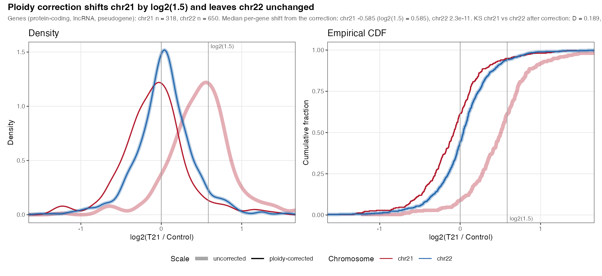
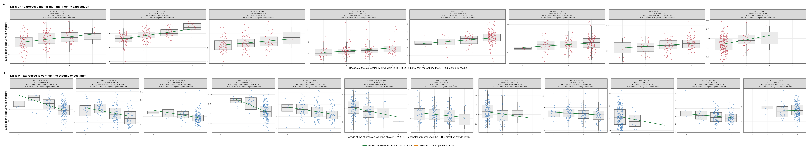
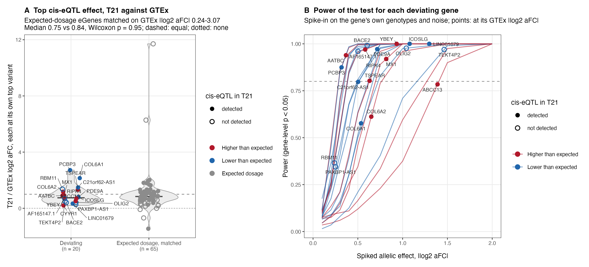

```{r setup, include=FALSE}
knitr::opts_chunk$set(echo = FALSE, message = FALSE, warning = FALSE)
suppressPackageStartupMessages({
  library(dplyr)
  library(knitr)
  library(here)
})

lanes <- read.csv(here("results/runs/baseline/tables/chr21_lane_assignments.csv"))
dev   <- lanes %>% filter(sig_lane %in% c("DE_high", "DE_low"))

n_total    <- nrow(lanes)
bm_cut     <- 30  # script 04's low-expression cutoff (Hunter et al.'s coverage floor)
n_pc       <- sum(lanes$Gene_type == "protein_coding")
n_lnc      <- sum(lanes$Gene_type == "lncRNA")
n_pseudo   <- sum(grepl("pseudogene", lanes$Gene_type))
n_expected <- sum(lanes$sig_lane == "Expected_dosage")
n_repeat   <- sum(lanes$sig_lane == "High_repeats")
n_lowexpr  <- sum(lanes$sig_lane == "Low_expression")
n_dev      <- nrow(dev)
n_high     <- sum(dev$sig_lane == "DE_high")
n_low      <- sum(dev$sig_lane == "DE_low")
n_tier1    <- sum(dev$tier == 1)
n_tier2    <- sum(dev$tier == 2)
n_cis      <- sum(dev$eqtl_lane == "cis_eqtl")
n_nocis    <- sum(dev$eqtl_lane == "no_cis_eqtl")
n_nogtex   <- sum(dev$eqtl_lane == "no_GTEx_data")

gene_list <- function(d) paste(sort(d$Gene_name), collapse = ", ")
cand_tested   <- dev %>% filter(eqtl_lane == "no_cis_eqtl")
cand_untested <- dev %>% filter(eqtl_lane == "no_GTEx_data")

git_rev <- tryCatch(
  system("git rev-parse --short HEAD", intern = TRUE),
  error = function(e) "unknown"
)
```

Rendered at commit `` `r git_rev` `` (the commit checked out when this
document was last knitted; `results/` is gitignored, so the outputs
themselves are not versioned). This document reads:

- `results/runs/baseline/tables/`: `chr21_lane_assignments.csv` (script
  04) - every number and gene list in the baseline sections;
  `base_rate_summary.csv` (script 16); `spike_in_power_genes.csv` (script
  15); `distal_inflation_summary.csv` (script 17);
  `detection_vs_effect_size_summary.csv` and
  `top_variant_effect_ratio_summary.csv` (script 18).
- `config/runs/baseline.R` - the thresholds quoted in the text.
- `results/runs/adjusted/`: `processed/cohort_roster.csv` (script 01);
  `tables/chr21_lane_assignments.csv` (script 04);
  `tables/run_comparison_adjusted_vs_baseline.csv` (script 10).
- `docs/figures/` - the PNGs embedded under Figures and in the adjusted-run
  section (copies of the outputs of scripts 06, 07, 10, 11, 18 and S1), and
  `Sankey.png`, the SankeyMATIC render of
  `results/runs/<run>/tables/chr21_lane_sankeymatic_input.txt` (script 05).

To refresh after a pipeline run:
`Rscript -e 'rmarkdown::render("docs/summary.Rmd")'`. Methodology and
its history: `README.md` and `docs/decisions.md`.

## Overview

Of the **`r n_total`** chr21 genes classified (**`r n_pc`** protein-coding,
**`r n_lnc`** lncRNA, **`r n_pseudo`** pseudogene: the biotypes GTEx whole
blood tests for cis-eQTLs):
**`r n_expected`** are Expected dosage, **`r n_repeat`** are flagged as high repeats and
**`r n_lowexpr`** low-expression (baseMean below Hunter et al.'s coverage
floor of `r bm_cut`), and
**`r n_dev`** deviate (**`r n_high`** DE_high, **`r n_low`** DE_low;
**`r n_tier1`** tier 1 (padj < 0.01 and |corrected log2FC| >= log2(1.5), a
fold-change magnitude of 1.5 in either direction), **`r n_tier2`** tier 2,
near-threshold (padj < 0.01 and log2(4/3) <= |corrected log2FC| <
log2(1.5))). Of the deviating genes,
**`r n_cis`** have a detectable GTEx whole-blood cis-eQTL, **`r n_nocis`**
were tested and have none, and **`r n_nogtex`** have no GTEx cis coverage.
A cis-eQTL call is a detection result (q_gene_bh < 0.05), not an
"explained by eQTL" claim.

## Deviating genes

Deviating genes that carry no detected cis-eQTL. These deviations are not
accompanied by detectable cis-regulatory variation; the pipeline does not
attribute them to a mechanism:

- Tested against GTEx, no detection (`r nrow(cand_tested)`):
  **`r gene_list(cand_tested)`**
- No GTEx cis coverage, untestable here (`r nrow(cand_untested)`):
  **`r gene_list(cand_untested)`**

## Reference sets for the eQTL test

```{r refs-setup, include=FALSE}
th    <- source(here("config/runs/baseline.R"))$value$thresholds
tb    <- function(f) read.csv(here("results/runs/baseline/tables", f), check.names = FALSE)
br    <- tb("base_rate_summary.csv")
det   <- tb("detection_vs_effect_size_summary.csv")[1, ]
ratio <- tb("top_variant_effect_ratio_summary.csv")
pw    <- tb("spike_in_power_genes.csv")
lam   <- tb("distal_inflation_summary.csv")
lam   <- lam[lam$variant_set == "q-arm only", ]
rs  <- function(set, col) ratio[[col]][ratio$set == set]
lm1 <- function(set, col) lam[[col]][lam$gene_set == set]
pct <- function(x) sprintf("%.0f%%", 100 * x)
```

The gene-level test is read against references that use the whole of
chr21 (the standalone decoy and matched positive controls were retired on
2026-10-05; `docs/decisions.md`).

**Every Expected-dosage gene (script 16).** The identical test on every
Expected-dosage gene with GTEx cis variants detects a cis-eQTL for
`r br$n_detected[2]` of `r br$n_tested[2]` (`r br$pct_detected[2]`%),
against `r br$n_detected[1]` of `r br$n_tested[1]` deviating genes.

**At matched effect size (script 18).** Detection rises with GTEx effect
size, so the deviating genes are compared with the
`r det$n_expected_dosage_egenes` Expected-dosage GTEx eGenes at their own
GTEx |aFC|: `r det$expected` detections expected, `r det$observed` observed
(Poisson-binomial P(>= observed) = `r det$p_at_least`; odds ratio at
matched effect size `r det$odds_ratio_deviating`,
`r det$or_ci_lo` to `r det$or_ci_hi`). Each dataset's own top cis-eQTL
effect, T21 aFC at the T21 best variant over GTEx aFC at its lead variant,
has median `r rs("Deviating", "median_ratio")` for the deviating genes and
`r rs("Expected dosage", "median_ratio")` for the
`r rs("Expected dosage", "n")` Expected-dosage eGenes in the same GTEx
|aFC| range (Wilcoxon p = `r ratio$wilcoxon_p[1]`).

**Power (script 15).** Spiking each tested deviating gene's GTEx aFC into
its own permuted expression, the test reaches gene-level p < 0.05 in
`r pct(min(pw$power_at_gtex_afc_p05))` to
`r pct(max(pw$power_at_gtex_afc_p05))` of simulations;
`r sum(pw$power_at_gtex_afc_p05 >= 0.8)` of `r nrow(pw)` genes are at 80%
power or more.

**Negative control (script 17).** Every assessable gene's expression
against every common chr21 long-arm variant at least
`r th$distal_min_distance / 1e6` Mb from its TSS: lambda
`r lm1("chr21 assessable", "lambda")` for chr21 genes (permutation range
`r lm1("chr21 assessable", "perm_lo")` to
`r lm1("chr21 assessable", "perm_hi")`) and
`r lm1("chr22 reference", "lambda")` for chr22 genes. The baseline run has
no covariates, and its tests carry genotype structure on both chromosomes;
the adjusted run's covariates bring lambda within its permutation range
(`docs/decisions.md`).

## Figures

Copies of the pipeline figures, tracked under `docs/figures/`. To refresh
them, re-run scripts 06, 07, 11, 15, 16, 18 and S1 for each run (and re-export the lane flow from
SankeyMATIC using `results/runs/<run>/tables/chr21_lane_sankeymatic_input.txt`), copy
the PNGs into `docs/figures/`, and re-render this document.

### Effect of ploidy correction on the log2FC distribution: chr21 uncorrected vs corrected, with chr22 as the unchanged control (script 06):

```{r fig-dist, out.width="100%", fig.alt="Two-panel figure. Left: overlaid density curves of log2 fold change (T21 vs Control) for chr21 and chr22 genes (protein-coding, lncRNA, pseudogene), each on the uncorrected and the ploidy-corrected scale. The uncorrected chr21 curve is centred near log2(1.5); the ploidy-corrected chr21 curve is shifted left by that amount, centres on zero and overlaps chr22. The two chr22 curves coincide. Right: the corresponding empirical cumulative distributions. Vertical reference lines mark 0 and log2(1.5)."}

```

### Volcano plots, all genes before and after ploidy correction (script 07):

```{r fig-volcano-all, out.width="100%", fig.alt="Two volcano plots of log2 fold change (T21 vs Control) against minus log10 adjusted p-value, all genes of the target biotypes in grey with chr21 genes in purple. Left, uncorrected: the chr21 cloud sits to the right of zero around the 1.5-fold expectation, marked by a dotted line, and is almost uniformly significant. Right, ploidy-corrected: the chr21 cloud is centred on zero and most of its significance is gone."}
include_graphics("./figures/baseline_volcano_all_genes.png")
```

### Volcano plots, chr21 only, deviating genes labelled (script 07):

```{r fig-volcano-chr21, out.width="100%", fig.alt="Two volcano plots restricted to chr21 genes, uncorrected on the left and ploidy-corrected on the right. Deviating genes are labelled and coloured by direction, red for higher than expected and blue for lower than expected, with tier 1 genes in bold; all other chr21 genes are grey."}
include_graphics("./figures/baseline_volcano_chr21.png")
```

### Expression by genotype for every tested deviating gene (script 11):

```{r fig-dosage-panels, out.width="100%", fig.alt="Two rows of box-and-jitter panels, one per tested deviating gene, showing expression in T21 subjects against the dosage (0 to 3 copies) at the gene's best variant of the allele whose GTEx effect runs the way the gene deviates. Row A, DE high genes in red, is drawn on the expression-raising allele, so a panel that reproduces GTEx trends up; row B, DE low genes in blue, on the expression-lowering allele, so it trends down. Each strip names the gene, the permutation q, the variant, the plotted allele, the minor allele and its MAF, the GTEx direction and whether the within-T21 trend agrees. Every trend line is green, meaning the within-T21 trend matches the GTEx direction."}

```

### Top cis-eQTL effect against matched Expected-dosage genes, and power (scripts 15, 16, 18):

Panel A is each gene's T21 allelic fold change at its T21 best variant,
signed by GTEx's direction there, over the GTEx allelic fold change at its
lead variant, for the deviating genes and the Expected-dosage GTEx eGenes in
the same GTEx |aFC| range. Panel B is the power of the gene-level test at
each tested deviating gene's own GTEx effect size, by spike-in.

```{r fig-detection-overview, out.width="100%", fig.alt="Two-panel figure. A: violin plots with jittered points of the ratio of T21 to GTEx log2 allelic fold change, each at its own top variant, for deviating genes (red if higher than expected, blue if lower) and Expected-dosage GTEx eGenes matched on GTEx effect size (grey), with filled points for genes with a detected cis-eQTL and open points for genes without, a dashed line at 1, a dotted line at 0 and a bar at each median; the two distributions overlap. B: spike-in power curves of the gene-level test against the spiked absolute log2 allelic fold change, one curve per tested deviating gene coloured by direction, with a point at the gene's GTEx effect size, filled if detected in T21 and open if not, and a dashed line at 80 percent power."}

```

### Deviating genes along chr21 (script 11):

```{r fig-chr21-map, out.width="100%", fig.alt="Schematic of chromosome 21 as a horizontal bar with the centromere in dark grey. A coloured band marks the transcription start site of each deviating gene: green for cis-eQTL detected, orange for tested without detection, grey for no GTEx coverage. Gene names sit above the bar in red for genes higher than expected and below the bar in blue for genes lower than expected."}
include_graphics("./figures/baseline_chr21_deviating_map.png")
```

### Sankey plot generated with SankeyMATIC

```{r fig-sankey, out.width="100%", fig.alt="Sankey diagram of the chr21 genes (protein-coding, lncRNA, pseudogene). From the full set, flows split into Expected dosage, Not assessable (which divides into High repeats and Low expression), and Outside dosage expectation. The last divides into DE high and DE low, which then terminate at cis-eQTL detected, no GTEx cis-eQTL data (labelled 'no GTEX QTL' in the figure), or no cis-eQTL detected. Node labels carry the gene counts."}
include_graphics("./figures/Sankey.png")
```

## Covariate-adjusted run

```{r adjusted-setup, include=FALSE}
adj_dir   <- here("results/runs/adjusted")
roster_a  <- read.csv(file.path(adj_dir, "processed/cohort_roster.csv"))
roster_a$excluded_reason[roster_a$excluded_reason == ""] <- NA
cohort_a  <- roster_a[is.na(roster_a$excluded_reason), ]
lanes_a   <- read.csv(file.path(adj_dir, "tables/chr21_lane_assignments.csv"))
cmp       <- read.csv(file.path(adj_dir, "tables/run_comparison_adjusted_vs_baseline.csv"))
n_dev_b   <- sum(lanes$sig_lane %in% c("DE_high", "DE_low"))
kept_both <- cmp$Gene_name[cmp$sig_lane_baseline %in% c("DE_high", "DE_low") & cmp$sig_lane_adjusted %in% c("DE_high", "DE_low")]
lost      <- cmp$Gene_name[cmp$sig_lane_baseline %in% c("DE_high", "DE_low") & !(cmp$sig_lane_adjusted %in% c("DE_high", "DE_low"))]
gained    <- cmp$Gene_name[!(cmp$sig_lane_baseline %in% c("DE_high", "DE_low")) & cmp$sig_lane_adjusted %in% c("DE_high", "DE_low")]
n_outside <- sum(lanes_a$sig_lane == "Not_DE_outside_noise")
```

The baseline result above follows Hunter et al.: no covariates. Age, BMI,
sample source and visit differ between T21 and control subjects in this
cohort (S1 panel A), blood cell composition differs by karyotype and
tracks thousands of genes (S1 panel B), and `r sum(roster_a$karyotype_subtype == "mosaic_T21", na.rm = TRUE)`
T21 subjects are mosaic, with a chr21 expression index near 1.07 rather
than 1.35 (S1 panel C). The `adjusted` run (`config/runs/adjusted.R`)
therefore fits `~ age + sex + BMI + sample source + 19 CyTOF cell
fractions + karyotype` on the `r nrow(cohort_a)` samples
(`r sum(cohort_a$Karyotype == "T21")` T21, `r sum(cohort_a$Karyotype == "Control")` Control)
that have every covariate, with mosaic T21 excluded, and its eQTL stage
reads the covariate-adjusted expression artifact. It is reported beside the baseline, not instead of it: BMI and
composition are plausibly downstream of trisomy, so this run estimates the
deviation net of those pathways.

Of the `r n_dev_b` genes deviating in the baseline, `r length(kept_both)`
still deviate after adjustment (`r paste(kept_both, collapse = ", ")`),
`r length(lost)` do not (`r paste(lost, collapse = ", ")`), and
`r length(gained)` genes deviate only in the adjusted run
(`r paste(gained, collapse = ", ")`). `r n_outside` genes clear the
magnitude cut in the adjusted model without reaching padj < 0.01; the
adjusted model has 24 more parameters and `r 397 - nrow(cohort_a)` fewer
samples, so its adjusted p-values are less powerful as well as adjusted.

```{r fig-run-comparison, out.width="100%", fig.alt="One row per gene deviating in either run: ploidy-corrected log2 fold change under the baseline (orange) and adjusted (purple) runs, joined by a line, with a dotted line at zero."}
knitr::include_graphics("figures/adjusted_run_comparison_adjusted_vs_baseline.png")
```

```{r fig-s1, out.width="100%", fig.alt="Four-panel supplement. A: bar chart of minus log10 p for each candidate covariate against karyotype, coloured by whether it is in the adjusted model. B: number of genes associated with each CyTOF cell fraction within T21 at 5 percent FDR. C: chr21 expression index by karyotype subtype with reference lines at 1 and 1.5; mosaic subjects sit near 1. D: per-covariate contributions to each deviating gene's fold-change shift."}
knitr::include_graphics("figures/adjusted_S1_covariate_evidence.png")
```
