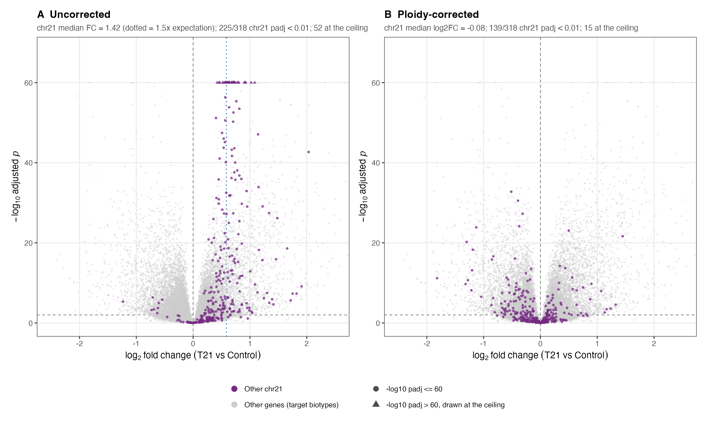
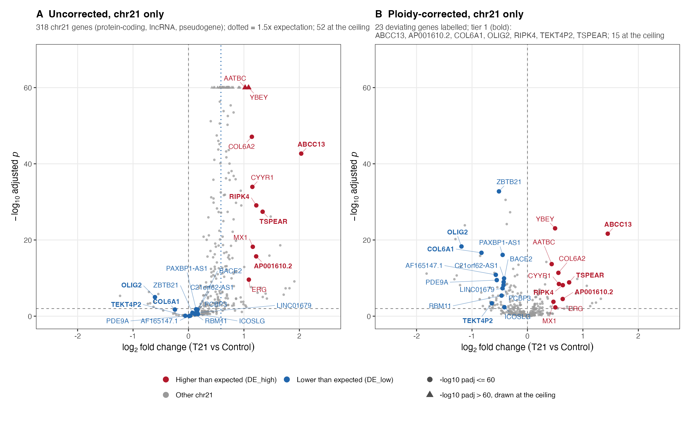
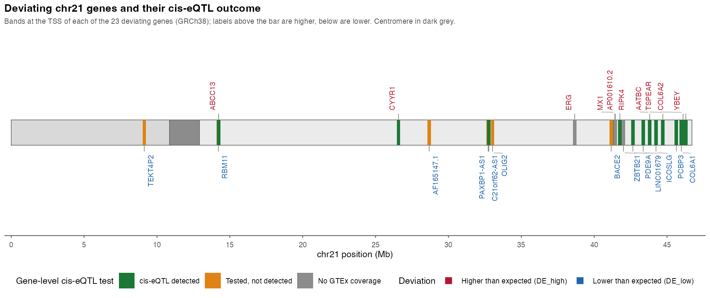
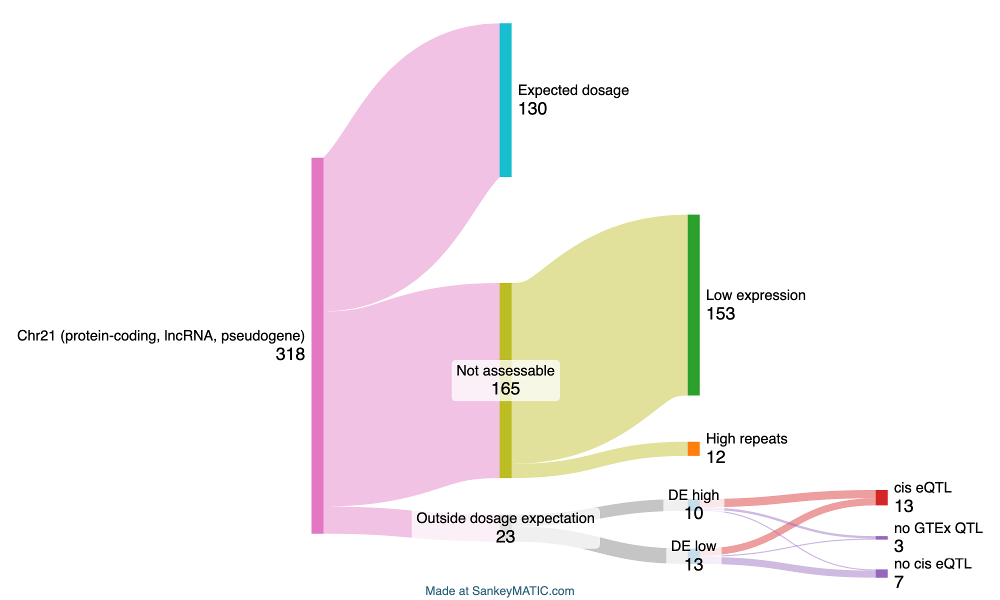
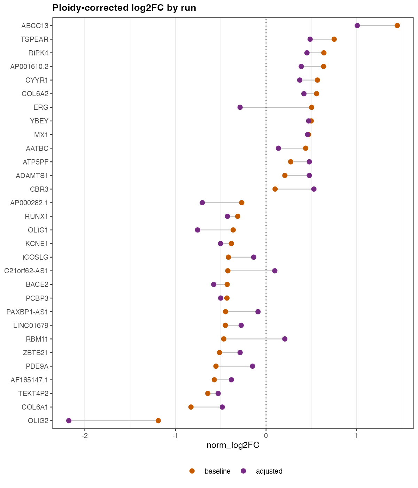
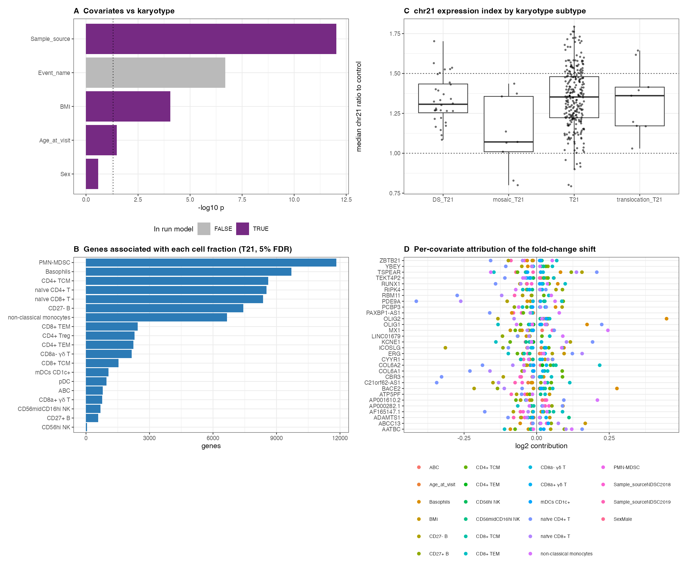

T21-eQTL results summary
================
2026-10-05

Rendered at commit `51a0361` (the commit checked out when this document
was last knitted; `results/` is gitignored, so the outputs themselves
are not versioned). This document reads:

- `results/runs/baseline/tables/`: `chr21_lane_assignments.csv` (script
  04\) - every number and gene list in the baseline sections;
  `base_rate_summary.csv` (script 16); `spike_in_power_genes.csv`
  (script 15); `distal_inflation_summary.csv` (script 17);
  `detection_vs_effect_size_summary.csv` and
  `top_variant_effect_ratio_summary.csv` (script 18).
- `config/runs/baseline.R` - the thresholds quoted in the text.
- `results/runs/adjusted/`: `processed/cohort_roster.csv` (script 01);
  `tables/chr21_lane_assignments.csv` (script 04);
  `tables/run_comparison_adjusted_vs_baseline.csv` (script 10).
- `docs/figures/` - the PNGs embedded under Figures and in the
  adjusted-run section (copies of the outputs of scripts 06, 07, 10, 11,
  18 and S1), and `Sankey.png`, the SankeyMATIC render of
  `results/runs/<run>/tables/chr21_lane_sankeymatic_input.txt` (script
  05).

To refresh after a pipeline run:
`Rscript -e 'rmarkdown::render("docs/summary.Rmd")'`. Methodology and
its history: `README.md` and `docs/decisions.md`.

## Overview

Of the **318** chr21 genes classified (**160** protein-coding, **129**
lncRNA, **29** pseudogene: the biotypes GTEx whole blood tests for
cis-eQTLs): **130** are Expected dosage, **12** are flagged as high
repeats and **153** low-expression (baseMean below Hunter et al.’s
coverage floor of 30), and **23** deviate (**10** DE_high, **13**
DE_low; **7** tier 1 (padj \< 0.01 and \|corrected log2FC\| \>=
log2(1.5), a fold-change magnitude of 1.5 in either direction), **16**
tier 2, near-threshold (padj \< 0.01 and log2(4/3) \<= \|corrected
log2FC\| \< log2(1.5))). Of the deviating genes, **14** have a
detectable GTEx whole-blood cis-eQTL, **6** were tested and have none,
and **3** have no GTEx cis coverage. A cis-eQTL call is a detection
result (q_gene_bh \< 0.05), not an “explained by eQTL” claim.

## Deviating genes

Deviating genes that carry no detected cis-eQTL. These deviations are
not accompanied by detectable cis-regulatory variation; the pipeline
does not attribute them to a mechanism:

- Tested against GTEx, no detection (6): **AF165147.1, BACE2, OLIG2,
  PAXBP1-AS1, RBM11, TEKT4P2**
- No GTEx cis coverage, untestable here (3): **AP001610.2, ERG, ZBTB21**

## Reference sets for the eQTL test

The gene-level test is read against references that use the whole of
chr21 (the standalone decoy and matched positive controls were retired
on 2026-10-05; `docs/decisions.md`).

**Every Expected-dosage gene (script 16).** The identical test on every
Expected-dosage gene with GTEx cis variants detects a cis-eQTL for 53 of
98 (54.1%), against 14 of 20 deviating genes.

**At matched effect size (script 18).** Detection rises with GTEx effect
size, so the deviating genes are compared with the 96 Expected-dosage
GTEx eGenes at their own GTEx \|aFC\|: 13.13 detections expected, 14
observed (Poisson-binomial P(\>= observed) = 0.437; odds ratio at
matched effect size 1.23, 0.42 to 3.92). Each dataset’s own top cis-eQTL
effect, T21 aFC at the T21 best variant over GTEx aFC at its lead
variant, has median 0.75 for the deviating genes and 0.84 for the 65
Expected-dosage eGenes in the same GTEx \|aFC\| range (Wilcoxon p =
0.95).

**Power (script 15).** Spiking each tested deviating gene’s GTEx aFC
into its own permuted expression, the test reaches gene-level p \< 0.05
in 34% to 100% of simulations; 14 of 20 genes are at 80% power or more.

**Negative control (script 17).** Every assessable gene’s expression
against every common chr21 long-arm variant at least 5 Mb from its TSS:
lambda 1.0739 for chr21 genes (permutation range 0.9616 to 1.0424) and
1.0444 for chr22 genes. The baseline run has no covariates, and its
tests carry genotype structure on both chromosomes; the adjusted run’s
covariates bring lambda within its permutation range
(`docs/decisions.md`).

## Figures

Copies of the pipeline figures, tracked under `docs/figures/`. To
refresh them, re-run scripts 06, 07, 11, 15, 16, 18 and S1 for each run
(and re-export the lane flow from SankeyMATIC using
`results/runs/<run>/tables/chr21_lane_sankeymatic_input.txt`), copy the
PNGs into `docs/figures/`, and re-render this document.

### Effect of ploidy correction on the log2FC distribution: chr21 uncorrected vs corrected, with chr22 as the unchanged control (script 06):

### Volcano plots, all genes before and after ploidy correction (script 07):

### Volcano plots, chr21 only, deviating genes labelled (script 07):

### Expression by genotype for every tested deviating gene (script 11):

### Top cis-eQTL effect against matched Expected-dosage genes, and power (scripts 15, 16, 18):

Panel A is each gene’s T21 allelic fold change at its T21 best variant,
signed by GTEx’s direction there, over the GTEx allelic fold change at
its lead variant, for the deviating genes and the Expected-dosage GTEx
eGenes in the same GTEx \|aFC\| range. Panel B is the power of the
gene-level test at each tested deviating gene’s own GTEx effect size, by
spike-in.

### Deviating genes along chr21 (script 11):

### Sankey plot generated with SankeyMATIC

## Covariate-adjusted run

The baseline result above follows Hunter et al.: no covariates. Age,
BMI, sample source and visit differ between T21 and control subjects in
this cohort (S1 panel A), blood cell composition differs by karyotype
and tracks thousands of genes (S1 panel B), and 9 T21 subjects are
mosaic, with a chr21 expression index near 1.07 rather than 1.35 (S1
panel C). The `adjusted` run (`config/runs/adjusted.R`) therefore fits
`~ age + sex + BMI + sample source + 19 CyTOF cell fractions + karyotype`
on the 354 samples (274 T21, 80 Control) that have every covariate, with
mosaic T21 excluded, and its eQTL stage reads the covariate-adjusted
expression artifact. It is reported beside the baseline, not instead of
it: BMI and composition are plausibly downstream of trisomy, so this run
estimates the deviation net of those pathways.

Of the 23 genes deviating in the baseline, 6 still deviate after
adjustment (OLIG2, PCBP3, BACE2, YBEY, COL6A2, ABCC13), 17 do not
(COL6A1, TEKT4P2, AF165147.1, PDE9A, ZBTB21, RBM11, LINC01679,
PAXBP1-AS1, C21orf62-AS1, ICOSLG, AATBC, MX1, ERG, CYYR1, AP001610.2,
RIPK4, TSPEAR), and 7 genes deviate only in the adjusted run (KCNE1,
OLIG1, RUNX1, AP000282.1, CBR3, ADAMTS1, ATP5PF). 11 genes clear the
magnitude cut in the adjusted model without reaching padj \< 0.01; the
adjusted model has 24 more parameters and 43 fewer samples, so its
adjusted p-values are less powerful as well as adjusted.

